# CommerceLab — Django Multi-Seller Commerce (local development)

This archive replaces the earlier broken starter ZIP. It includes a Django/DRF storefront, customer signup and JWT login/logout, opt-in seller onboarding, seller product/variant/image forms, product catalog, customer cart, addresses, checkout, order history, mock payment simulator, seller order list/shipping, reviews API, admin analytics API, PostgreSQL, Redis, Celery, Swagger and basic tests.

## Important limitations

**Local development demo, not a production-certified marketplace.** Payment simulation is not real money. It is enabled only with `DJANGO_DEBUG=1` and `MOCK_PAYMENTS_ENABLED=1`; turn it off outside local development. The simple seller self-onboarding is suitable for demonstration, not a verified/KYC seller program. The project does not implement real Stripe/Razorpay, real refunds, shipping carrier integrations, taxes, fraud prevention, multi-vendor split fulfillment, email verification or production hardening. These must be implemented and audited before real commerce use.

## Start clean on Windows (PowerShell)

1. Extract this ZIP to a NEW folder; do not overwrite your previous project.
2. `cd advanced_ecommerce`
3. `Copy-Item .env.example .env` and edit the passwords and secret key to your own values. Keep `POSTGRES_PASSWORD` consistent in `.env` (no DATABASE_URL parsing is used).
4. Stop the previous project's web container if it occupies port 8000: in the previous project directory, run `docker compose stop web` (this preserves its database).
5. `docker compose up -d --build`
6. `docker compose ps` and `docker compose logs --tail=80 web` if needed.
7. Open `http://localhost:8000/` and `http://localhost:8000/api/docs/`.

The compose project name is **commercelab_complete_v2**, so its PostgreSQL volume is separate from earlier versions. The first boot automatically creates and persists app migration files to the extracted folder, migrates, and seeds six categories (no users or products). On later boots, `makemigrations` should report no changes. For deployment, commit generated migrations and replace this development-only startup workflow with `python manage.py migrate --noinput`.

## UI testing flow

1. Register customer at homepage -> Register. Sign in; the navbar shows Logout.
2. Open Seller dashboard, click Become a seller. This upgrades the account in the demo.
3. Create a product, then a variant (SKU, price, stock), then optionally upload an image.
4. Shop -> select product -> add to cart.
5. Create delivery address -> checkout -> mock payment success or failure.
6. My orders -> seller orders. Swagger endpoints work with JWT access token.

## Security notes

The mock gateway accepts authenticated customers for their own pending orders only, and only when debug+mock flags are on. JWT logout clears this tab's sessionStorage token but does not revoke an issued token server-side. Seller onboarding is intentionally self-service for demo; production requires seller vetting. Django Admin remains available for trusted operators but is not required to populate products. Static UI and API permissions are separate; do not rely on hidden links for access control.

## Tests

Inside the container: `docker compose exec web python manage.py check` and `docker compose exec web pytest -q`. Docker runtime is not available in the environment that assembled this ZIP, so Docker startup and end-to-end browser flows have **not** been executed here.

## 📸 Project Screenshots

### Cartiva Website & API Documentation

| Screenshot | Preview |
|---|---|
| 1 | 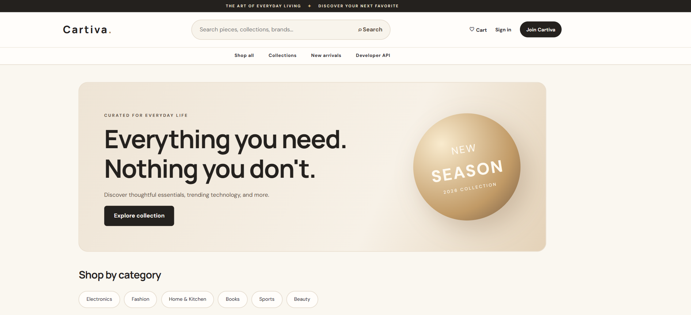 |
| 2 | 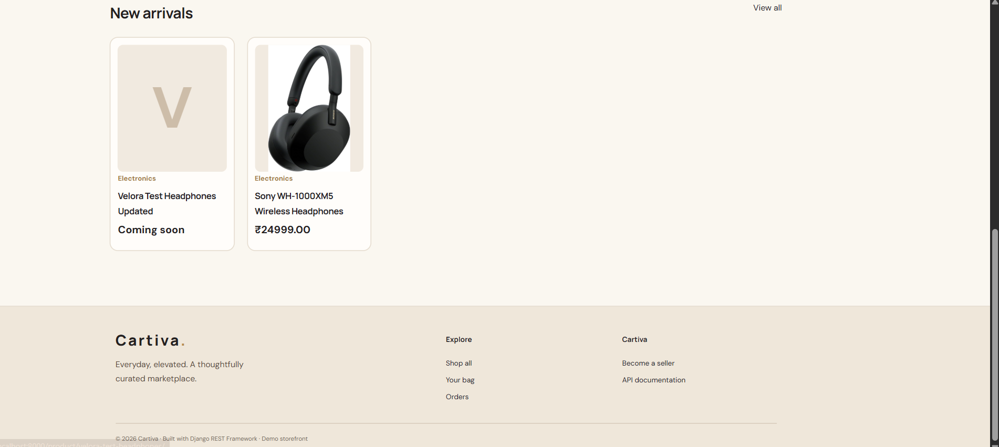 |
| 3 | 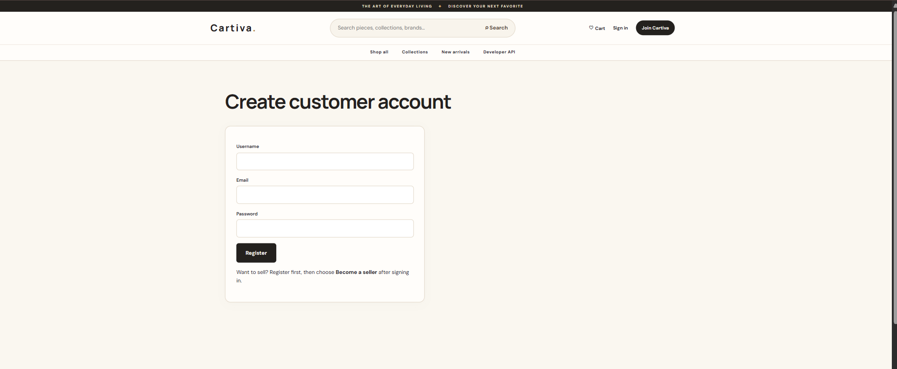 |
| 4 | 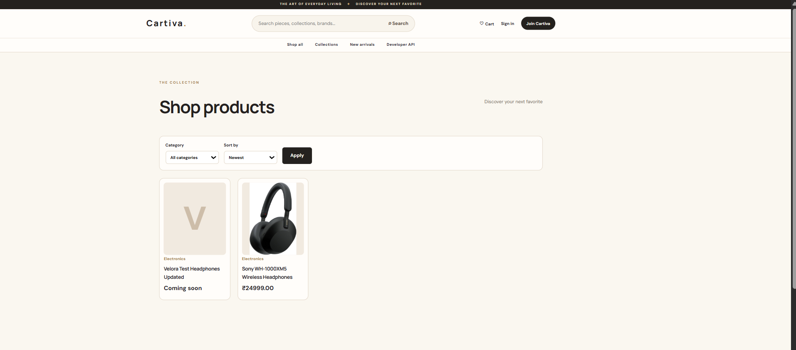 |
| 5 | 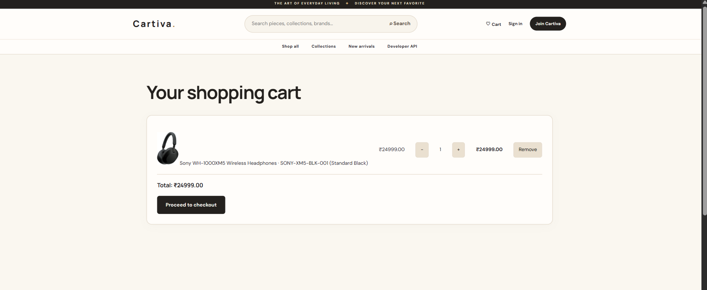 |
| 6 | 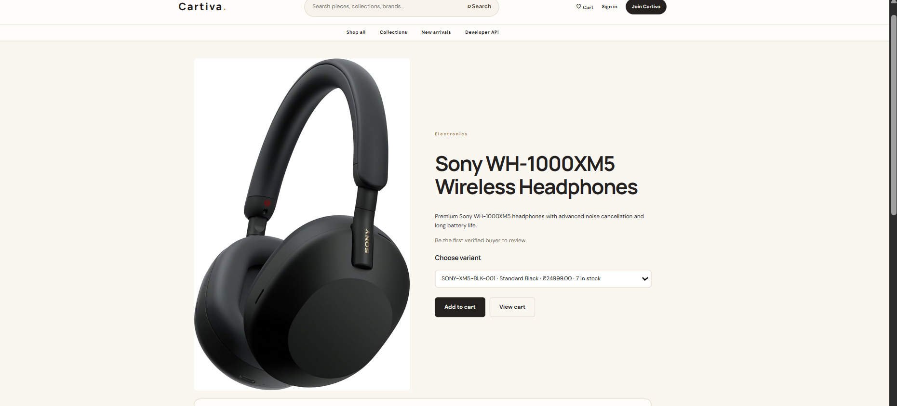 |
| 7 | 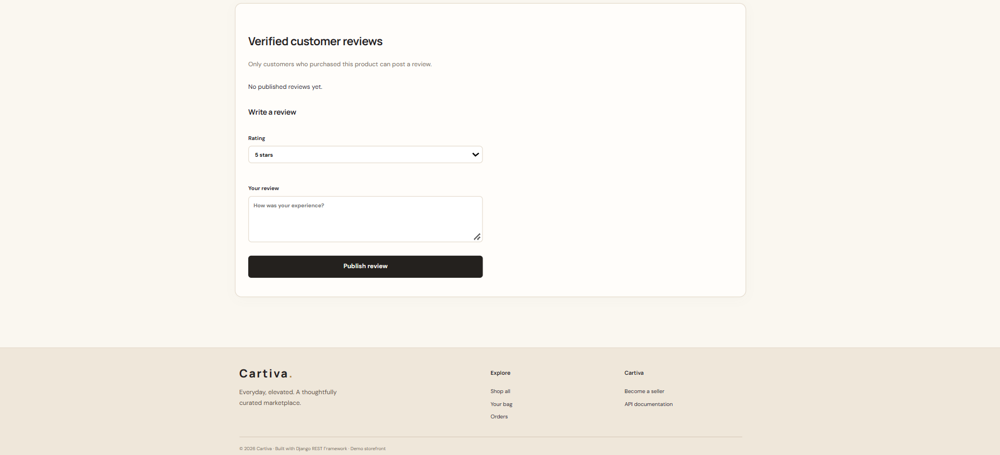 |
| 8 | 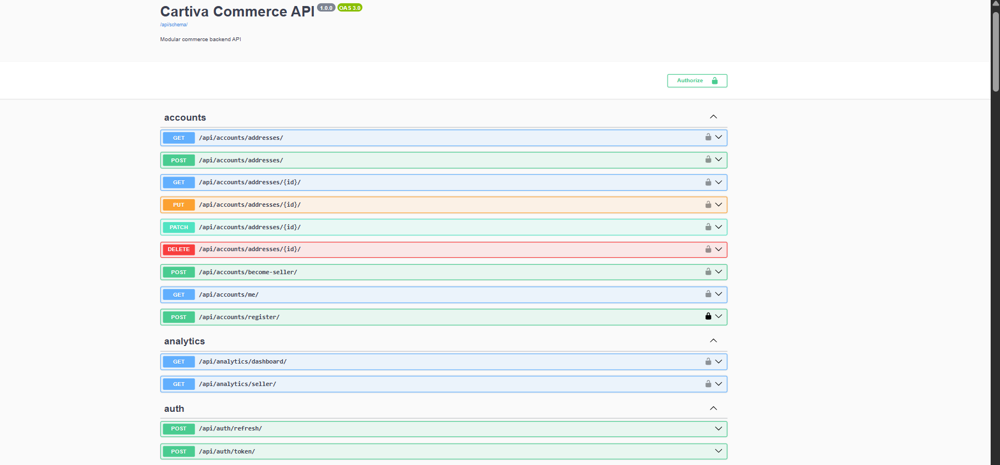 |
| 9 | 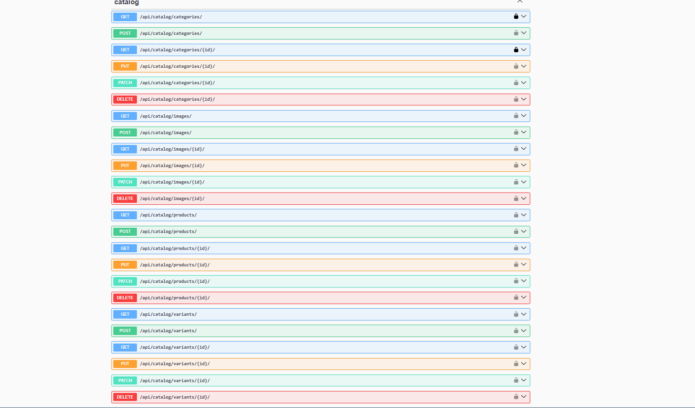 |
| 10 | 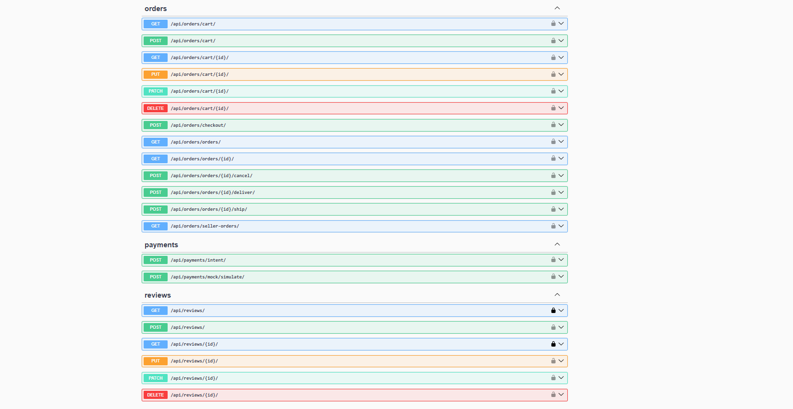 |
| 11 | 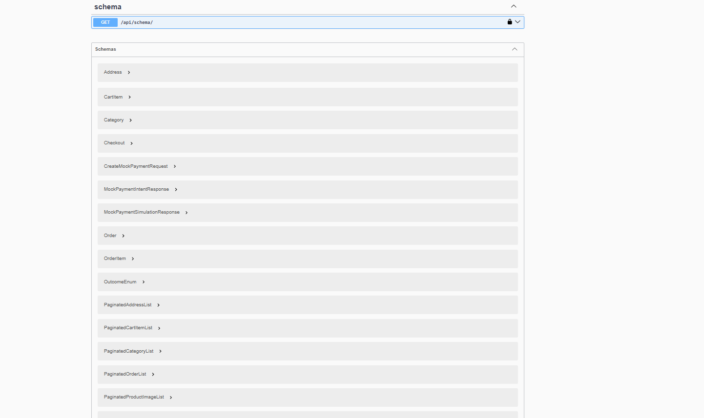 |

---

## Project Status

Cartiva is a portfolio e-commerce project developed using Django REST Framework, PostgreSQL, Redis, Celery, and Docker.

The application includes multi-vendor product management, JWT authentication, role-based access control, shopping carts, idempotent checkout, mock payment processing, order tracking, customer reviews, and analytics.

The project has been tested through Swagger UI, and automated CI checks are configured using GitHub Actions.

**Note:** Payment processing uses a mock payment system for demonstration purposes. No real financial transactions are performed.

---

**Developed as a backend engineering portfolio project.**

---

### Developed By

**CS Sai**  
Python Backend Developer

License: MIT License

**GitHub:** [My GitHub Profile]([(https://github.com/saiarvindcs/)])

---

_© 2026 CS Sai. All rights reserved._

_This is an multi-vendor e-commerce platform built to demonstrate backend engineering, REST API design, secure authentication, and scalable application architecture. Payment transactions are simulated for demonstration purposes._
